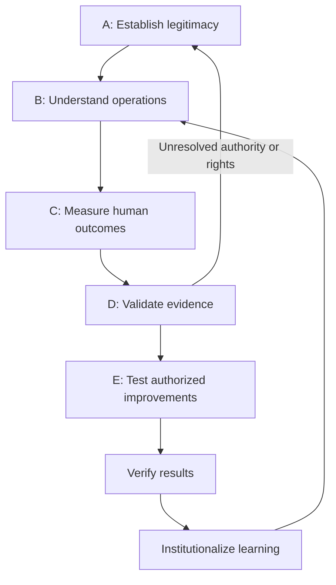

# The Five-Layer Architecture — A–E

The five layers are connected research and operating-design workstreams. This index preserves the user-supplied architectural descriptions and links them to actual repository material. The full linked Google Docs have not been imported. The framework is proposed and is not claimed to be a validated universal government standard.

| Layer | Architecture page | Purpose | Current scope |
| --- | --- | --- | --- |
| A | [Constitutional Legitimacy](layers/A-constitutional-legitimacy.md) | Establishes the legal, constitutional, democratic, and ethical foundations that govern every proposed intervention. | Review scaffolding and structural validation; qualified legal/institutional acceptance pending |
| B | [Government Operations](layers/B-government-operations.md) | Examines how public institutions convert lawful authority, public funding, personnel, information, procurement, and infrastructure into reliable services. | Operations documentation and synthetic local prototypes; live services not established |
| C | [Human and Community Outcomes](layers/C-human-community-outcomes.md) | Evaluates whether public services and investments produce meaningful, measurable improvements in people’s lives. | Dedicated synthetic workspace; full source review and real-world acceptance pending |
| D | [Intelligence and Evidence](layers/D-intelligence-evidence.md) | Provides the shared research and analytical foundation for the initiative. | Dedicated synthetic workspace; full source review and real-world acceptance pending |
| E | [Transformation and Institutional Learning](layers/E-transformation-learning.md) | Connects diagnosis to implementation. | Dedicated synthetic workspace; full source review and real-world acceptance pending |

## Proposed operating cycle

The cycle is iterative. A favorable operational measure does not clear an unresolved legal/rights hold. Testing or deployment needs its own applicable institutional authorization; simulation controls cannot supply it.

## Where the code and documents are

- [Detailed Layer A architecture](Layer-a-overview.md) and [A1–A7 domain prompts](../Domains/README.md).
- [Detailed Layer B architecture](../../layer-b/docs/Architecture/layer-b-overview.md).
- [Existing cross-layer alignment](../../layer-b/docs/Architecture/five-layer-alignment.md).
- [All 50 project slots and scenario coverage](../../layer-b/portfolio/CONTROL-COVERAGE.md).
- [Machine-readable user-supplied summaries](../../layer-b/portfolio/five-layer-architecture.json).

The repository began as Layer A with an imported Layer B subtree. C, D and E now have dedicated synthetic outcome, evidence and rehearsal workspaces within that subtree. See the [C/D/E workspace guide](../../layer-b/portfolio/LAYER-WORKSPACES.md). They remain bounded prototypes rather than complete institutional implementations. Scenario observations are not verified human outcomes, method notes are not benchmarked multi-agent execution, and simulated rollback is not institutional adoption.

Full source import, six unresolved project definitions, actual evaluation and qualified/institutional acceptance remain outstanding.
